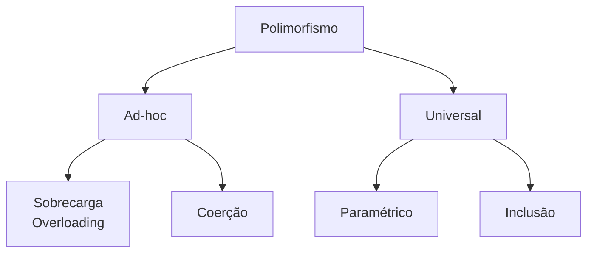

# Cap 7: Polimorfismo

## 🎭 Contextualizando

Às vezes precisamos que a mesma mensagem seja recebida por objetos de classes diferentes. Uma mensagem corresponde a um método, e uma classe é, na linguagem, um tipo — então essa necessidade se traduz em ter um **método que opere sobre diferentes tipos**: um método polimórfico. Em linguagens estaticamente tipadas, onde cada variável e parâmetro está amarrado a um tipo, isso parece à primeira vista contradizer a própria checagem estática. É exatamente para resolver essa tensão — flexibilidade sem abrir mão de segurança de tipos — que existem os diferentes mecanismos de polimorfismo.

Algumas definições, seguindo Cardelli e Wegner:

* **Linguagens polimórficas**: valores e variáveis podem ter mais de um tipo.
* **Funções polimórficas**: seus parâmetros podem aceitar mais de um tipo.
* **Tipos polimórficos**: tipos cujas operações se aplicam a valores de mais de um tipo.

Cardelli e Wegner propõem uma classificação em duas grandes famílias — **ad-hoc** e **universal** — cada uma com dois mecanismos:



A diferença conceitual entre as duas famílias é importante: no polimorfismo **universal**, a mesma função executa exatamente o **mesmo código** para argumentos de qualquer tipo admissível — por isso é considerado o polimorfismo "de verdade". No polimorfismo **ad-hoc**, a função pode executar código **diferente** para cada tipo — é, na prática, mais parecido com várias funções distintas compartilhando um nome do que com uma única função genuinamente genérica.

## 🎨 Polimorfismo Ad-hoc

### Sobrecarga (*overloading*)

O mesmo nome é usado para funções diferentes; o contexto (os tipos dos argumentos) decide qual delas é chamada em cada ponto do código:

```java
static double maior(double x, double y) {
    return x > y ? x : y;
}

static int maior(int x, int y) {
    return x > y ? x : y;
}

public static void main(String[] args) {
    System.out.println(maior(1.5, 1.8)); // chama a versão double
    System.out.println(maior(10, 20));   // chama a versão int
}
```

A resolução de qual método `maior` é chamado acontece em **tempo de compilação**, com base nos tipos estáticos dos argumentos — por isso sobrecarga é considerada polimorfismo *ad-hoc*: não existe um único algoritmo genérico por trás, existem métodos distintos, resolvidos estaticamente pelo compilador.

### Coerção

Uma conversão implícita de tipo, necessária para evitar um erro de tipo que ocorreria de outra forma — o que na Unidade 1 chamamos de conversão implícita (*widening*):

```java
int w = 3;
double y = 5.2;
double x = w + y; // w é implicitamente convertido (coagido) para double antes da soma
```

## 🌐 Polimorfismo Universal

### Paramétrico (Generics)

No polimorfismo paramétrico, uma função tem um **parâmetro de tipo** (implícito ou explícito) que determina o tipo dos argumentos em cada aplicação — e o mesmo código roda igualmente bem para qualquer tipo que satisfaça as restrições.

Em C++, isso é implementado por *templates*:

```cpp
template <class T>
T maior(T a, T b) {
    return (a > b) ? a : b;
}
```

Em Java, desde a versão 5, o mecanismo equivalente são os **generics** — conceitualmente parecido com templates, mas implementado de forma bem diferente (por *type erasure*, ao contrário da instanciação de templates do C++). Como Java não tem sobrecarga de operadores, comparação precisa passar por um método como `compareTo`:

```java
class Comparadores {
    public static <T extends Comparable<T>> T maior(T a, T b) {
        return a.compareTo(b) > 0 ? a : b;
    }
}
```

Um tipo genérico completo — uma pilha que funciona para qualquer tipo comparável:

```java
public class PilhaGenerica<T extends Comparable<T>> {
    private final List<T> elementos = new ArrayList<>();

    public void empilhar(T x) {
        elementos.add(x);
    }

    public T desempilhar() {
        return elementos.remove(elementos.size() - 1);
    }

    public T maior() {
        return elementos.stream()
            .max(Comparable::compareTo)
            .orElseThrow(() -> new NoSuchElementException("pilha vazia"));
    }
}
```

```java
var pilha = new PilhaGenerica<Integer>();
pilha.empilhar(3);
pilha.empilhar(7);
pilha.empilhar(2);
System.out.println(pilha.maior()); // 7
```

!!! warning "Generics só funcionam com tipos de referência"
    Não é possível instanciar `PilhaGenerica<int>` — apenas `PilhaGenerica<Integer>`, usando o *wrapper* (com autoboxing cuidando da conversão automaticamente, como vimos na Unidade 1). Isso é uma limitação real de Java frente a C++, cujos *templates* funcionam igualmente bem com tipos primitivos.

## 🏗️ Polimorfismo de Inclusão

O tipo de polimorfismo mais diretamente ligado à herança (vista no capítulo anterior). Requer que os tipos estejam relacionados dentro de uma hierarquia de classes.

```java
Circle c = pc; // pc é PlaneCircle; atribuído a uma variável Circle, sem cast
```

Cada objeto `PlaneCircle` também é, validamente, um objeto `Circle`. Se `pc` referencia um `PlaneCircle`, é seguro atribuí-lo a uma variável `Circle` — esse é o princípio básico do polimorfismo de inclusão. Grady Booch resume: ocorre quando um mesmo nome denota instâncias de classes diferentes, relacionadas por uma superclasse comum.

```java
class Geometry {
    protected double x, y;
    public void draw() { /* ... */ }
}
class Circle extends Geometry {
    private double r;
    Circle(double r) { this.r = r; }
    // ...
}
class Rectangle extends Geometry {
    private double w, h;
    Rectangle(double w, double h) { this.w = w; this.h = h; }
    // ...
}
```

```java
Geometry geo;
geo = new Rectangle(3.0, 4.0);
// ...
geo = new Circle(2.0);
```

David Watt formaliza: polimorfismo de inclusão é um sistema de tipos em que um tipo pode ter subtipos, que herdam as operações desse tipo — onde um tipo `T` é um conjunto de valores equipado com operações, e um subtipo de `T` é um subconjunto desses valores, equipado com as mesmas operações. Todo valor do subtipo também é um valor do tipo `T`, e portanto pode ser usado em qualquer contexto que espera um valor de tipo `T`.

Essa propriedade é o que permite construir **coleções heterogêneas** de objetos de classes diferentes, desde que compartilhem um ancestral comum:

```java
List<Geometry> formas = new ArrayList<>();
formas.add(new Circle(2.0));
formas.add(new Rectangle(1.0, 3.0));

for (Geometry geo : formas) {
    geo.draw(); // este código NÃO precisa saber qual é a classe concreta de cada geo
}
```

### Sobrescrita e ligação dinâmica

Na prática, dificilmente um único método `draw` na superclasse conseguiria desenhar qualquer geometria — cada subclasse **sobrescreve** o método com sua própria implementação:

```java
class Geometry {
    public void draw() {
        System.out.println("executando o método de Geometry");
    }
}
class Circle extends Geometry {
    // atributos e construtor como antes
    Circle(double r) { /* ... */ }

    @Override
    public void draw() {
        System.out.println("executando o método de Circle");
    }
}
class Rectangle extends Geometry {
    Rectangle(double w, double h) { /* ... */ }

    @Override
    public void draw() {
        System.out.println("executando o método de Rectangle");
    }
}
```

O que este código imprime?

```java
Geometry geo = new Circle(2.0);
geo.draw();
```

Imprime **"executando o método de Circle"** — mesmo a variável `geo` sendo declarada como `Geometry`. Isso acontece porque em Java o despacho de métodos de instância é **virtual por padrão**: a decisão de qual implementação executar é tomada em **tempo de execução**, com base no tipo real do objeto, não no tipo declarado da variável. Esse mecanismo é chamado de **ligação dinâmica** (*dynamic dispatch*).

!!! note "Inclusão executa o mesmo código ou códigos diferentes?"
    No início do capítulo, dissemos que o polimorfismo universal executa o **mesmo código** para qualquer tipo admissível. Na inclusão, isso vale para o código que **usa** o supertipo: o laço que chama `geo.draw()` é um só e serve a qualquer subclasse, inclusive às que ainda serão escritas. Já o método que atende à chamada pode variar, quando há sobrescrita — um recurso que a orientação a objetos acrescenta à inclusão. Na sobrecarga é diferente: a escolha entre os métodos acontece na compilação, a cada ponto de chamada.

!!! note "Em C++, ligação dinâmica não é o padrão"
    O mesmo código em C++ **não** produz o mesmo resultado por padrão — a menos que o método seja explicitamente declarado `virtual`:

    ```cpp
    class Geometry {
    public:
        void draw() { std::cout << "Geometry\n"; }   // NÃO virtual
    };
    class Circle : public Geometry {
    public:
        void draw() { std::cout << "Circle\n"; }
    };

    Geometry* geo = new Circle();
    geo->draw(); // imprime "Geometry" — ligação ESTÁTICA, decidida em compilação!
    ```

    Só com `virtual void draw();` na superclasse o compilador C++ passa a gerar uma *vtable* (tabela de métodos virtuais) e a resolver a chamada dinamicamente, como Java faz por padrão. Essa diferença de design — despacho virtual por padrão em Java, opt-in em C++ — é um dos pontos de comparação mais citados entre as duas linguagens, e reforça por que Java "tem um modelo de objetos mais simplificado" em relação a C++ (retomando o Capítulo 2).

## 📝 Atividades

1. Classifique cada mecanismo — sobrecarga de `println`, generics em `List<T>`, `Comparable.compareTo`, uma variável `Animal a = new Cachorro()` — como ad-hoc ou universal, e como (se aplicável) coerção, sobrecarga, paramétrico ou inclusão.
2. Explique, com um exemplo, a diferença entre **sobrecarga** (*overloading*, mesmo nome, assinaturas diferentes, resolução em compilação) e **sobrescrita** (*overriding*, mesma assinatura, resolução em execução).
3. Escreva uma hierarquia `Funcionario` → `Gerente`, `Vendedor`, cada um sobrescrevendo um método `calcularBonus()`. Escreva um método que recebe `List<Funcionario>` e soma os bônus de todos, sem precisar saber a subclasse concreta de cada um.
4. Pesquise: em Java, é possível ter **sobrecarga** de um método `static` e simultaneamente **sobrescrita** de um método de instância com o mesmo nome? O que muda no despacho de cada um?

## 🔗 Para saber mais

* Cardelli, L. & Wegner, P. — [*On Understanding Types, Data Abstraction, and Polymorphism*](http://lucacardelli.name/Papers/OnUnderstanding.A4.pdf)
* Watt, D. — *Programming Language Design Concepts*, capítulo sobre polimorfismo
